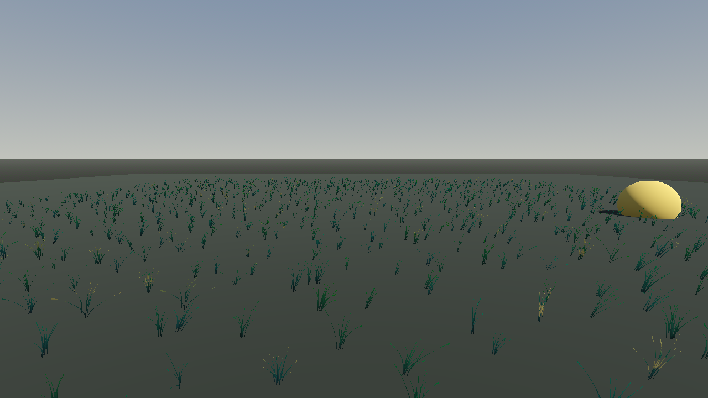

# Grass Painter



A self-contained GPU grass painting plugin for Godot 4.4+ (tested on 4.6). Paint
regions across your terrain, batch-fill them, carve exclusion circles, and define any
number of grass kinds via presets — zero-asset procedural blades out of the box, or
your own scanned/custom meshes.

## Install

1. Download this repository and copy the `addons/grass_painter/` folder into your
   project's `addons/` directory (or install via the Godot Asset Library).
2. Enable **Grass Painter** in Project > Project Settings > Plugins.
3. The **Grass Painter** tab appears in the editor's right dock.
4. Optional: open this repository as a Godot project and run `demo/demo.tscn` to see
   a live demo (procedural grass on a bare box ground, a sphere walking around and
   bending the grass).

The plugin is fully self-contained: every script, shader and default asset lives in
this folder. No paths outside the addon are required.

## Concepts

- **GrassRegion** (`core/grass_region.gd`): a Node3D defining a square area. Grass is
  scattered inside it and snapped to the ground with raycasts. Add one via the painter,
  or directly via *Add Child Node > GrassRegion*.
- **GrassPreset** (`core/grass_preset.gd`): a Resource defining one grass kind —
  geometry, material, LOD distance and default density/height. Share presets across
  regions by saving them as `.tres`.
- **Exclusion circles**: per-region "no grass" circles, painted inside regions
  (paths, stones, puddles).

## Modes (top dropdown)

| Mode | Mouse | Action |
|---|---|---|
| Fast paint | click | place one region at the click point |
| Fast paint | Shift+drag | batch-place a grid of regions inside the rectangle |
| Fast paint | Ctrl+click | erase the region under the cursor |
| Fast paint | Ctrl+Shift+drag | box-erase every region inside the rectangle |
| Exclusion pen | drag | paint exclusion circles (radius = the "exclusion circle radius" panel field) |
| Exclusion pen | Ctrl+drag | erase circles under the cursor |
| Exclusion pen | hover (no button) | preview ring |
| Select | — | viewport behaves normally |

`[` / `]` adjust the brush radius. `Esc` cancels the current drag; during an exclusion stroke
it rolls the whole stroke back to the pre-stroke state (nothing enters the undo history).
Pressing `Esc` while a frame-sliced batch/rebuild is running aborts it after the current
slice. Every completed operation is undoable (one undo step per gesture).

## Presets

The built-in **Procedural Default** generates blades in code (no assets, works
anywhere). To use scanned grass, flowers, reeds or any custom art:

1. Create a new `GrassPreset` resource (or use the panel's *save preset* button — the one
   with the 💾 icon — to capture the current scale parameters).
2. For external art set `is_procedural = false` and assign:
   - `lod0_assets`: near clump resources — each entry is one variant; use `Mesh` or
     `PackedScene` (scenes are merged and bottom-aligned automatically),
   - `lod1_assets` (optional): far variants such as cross cards,
   - `albedo_texture / normal_texture / trans_texture` with `shader_kind = SCAN`,
   - `avg_natural_ratio`: average natural height ratio of the assets (used when
     converting heights between presets so visual height is preserved).
3. Save it under e.g. `res://grass_presets/my_grass.tres` and pick it from the panel
   dropdown (the ↻ button rescans the folder).

Procedural personalities accept an optional `"dry": true` flag: that variant renders
as straw-colored dry stubble (almost no wind sway, no green gradient).

Keep licensed/private assets in your project, not inside the addon folder.

## Baked vs runtime grass

By default generated instances are baked into the scene. **Strip baking** (the two
"strip baked" buttons) flips regions to *rebuild on start* and clears the baked layers,
greatly shrinking the scene file; grass is then generated at runtime. Merge small regions
into large ones *before* stripping to avoid a first-frame hitch.

Note: the editor panel is currently localized in Chinese (button labels and tooltips);
everything in this README refers to it by position/function.

## Runtime interaction (player bending)

Grass bends away from the global shader vec3 parameter `grass_player_pos`; the plugin
registers it automatically on first load. Write the player's world position to it:

```gdscript
func _process(_delta: float) -> void:
	RenderingServer.global_shader_parameter_set("grass_player_pos", global_position)
```

## Troubleshooting

- **No grass at all**: the ground has no collider on the picking mask — enable a mesh
  fallback surface mode, or check *height window*, excluded names and face limit.
- **Grass floats / sinks**: pick the surface mode matching your ground (use *mesh
  first* for collider-free visual ground).
- **Too grid-like**: enable *degrid rotation*, increase tilt/thin/height variation.

## License

MIT — see [LICENSE](LICENSE). The plugin contains no third-party assets: blades are
generated procedurally in code, and the bundled default preset ships no textures or
meshes. Bring your own (licensed) art via a custom `GrassPreset`.

